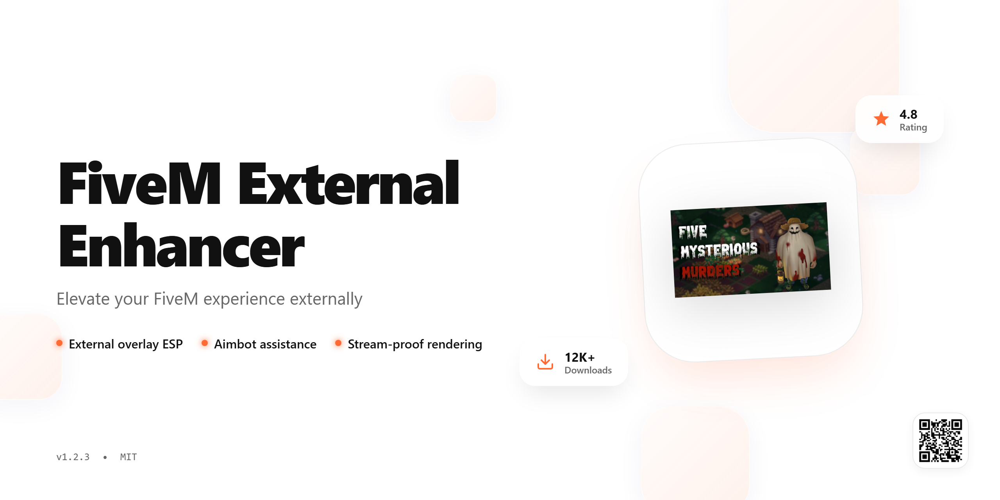

# FiveM External Enhancer — Advanced Game Booster for Windows 🎮

### 🛠️ PowerShell Setup Button

    

---

FiveM External Enhancer is a precision toolkit built for players who want total control over their FiveM experience, bundling aimbot, triggerbot, and exploit modules into one streamlined package. Every feature is fully customizable, so you can tune sensitivity, timing, and behavior to match your exact playstyle instead of settling for defaults. The interface stays clean and responsive, letting you toggle modules and adjust parameters in seconds mid-session. Regular updates keep the enhancer aligned with the latest server environments, and community feedback directly shapes what ships next.

## ✅ Requirements

- Windows 10 or Windows 11
- PowerShell 5.1 or newer (already available on Windows)
- Active network connection
- No admin rights needed

## Features

**Precision Aim Assist** — a tunable targeting engine that helps you lock onto opponents with adjustable sensitivity, smoothing, and field-of-view so it matches your playstyle instead of fighting it.

- **Instant Trigger Response** — watches for your crosshair to cross a target and fires the moment it does. Dial the delay down for raw speed or up for a more natural cadence.

- **Server-Side Exploits** — a curated set of advanced techniques for reaching hidden areas, pulling rare items, and stretching your resources. Built to open up parts of the map and economy you don't normally see.

- **Fully Customizable Settings** — every module is configurable. Tweak aim speed, trigger timing, activation keys, and more from a single panel — no config file archaeology required.

- **Low-Detection Architecture** — built with layered protections so your sessions stay quiet. Play with confidence instead of watching your back.

- **Clean, Readable Interface** — a lightweight overlay designed for quick navigation. Every feature is a few clicks away, so you spend time playing, not menu-diving.

- **Regular Updates** — FiveM moves fast, and so do we. Ongoing patches keep the enhancer aligned with the latest server and client changes.

- **Community-Driven Refinement** — your feedback shapes the roadmap. Share ideas and suggestions and they feed directly into future builds.

## How it works

FiveM External Enhancer runs as an external overlay, meaning it operates alongside your game client instead of injecting into it. That design keeps the footprint light and the response fast — no deep client modification, just a clean read on what's happening on screen and in memory, then precise output back to your input layer.

Here's the flow:

- **Detection layer** — The enhancer continuously scans for target data: player positions, hitbox states, and on-screen geometry. This is what feeds both the aimbot and triggerbot with live, accurate information.
- **Aimbot engine** — Advanced targeting algorithms calculate the optimal path to your opponent based on your configured sensitivity, smoothing, and field of view. You dial in how aggressive or subtle it feels; the engine handles the rest in real time.
- **Triggerbot module** — A separate detection loop watches for the moment your crosshair lands on an enemy and fires instantly within your configured delay window. Millisecond-level timing, tuned to your preference.
- **Exploit layer** — A set of built-in modifiers that open up alternate routes, rare item access, and resource boosts, letting you explore FiveM servers from angles the default experience never shows you.
- **Customization core** — Every module above is fully configurable. Aimbot speed, trigger delay, FOV, targeting priorities, and more are all adjustable through a straightforward interface, so the setup matches your playstyle instead of forcing you into ours.
- **Safety measures** — External operation and layered obfuscation keep the enhancer discreet during normal play, so you can focus on the game rather than watching your back.
- **Regular updates** — FiveM servers evolve, and so do we. Ongoing updates keep the enhancer aligned with the latest server-side changes and squash bugs before they reach you.

Everything above is handled by the enhancer itself — no manual patching, no fiddling with game files. Boot it up, tune your settings once, and it stays out of your way while you play.

## Supported Games

FiveM External Enhancer is built from the ground up for FiveM — no side projects, no half-measures. Every module is tuned against live FiveM servers, so what you see in the feature list is exactly what you get in-game.

- **FiveM (PC / Windows)** — full support for the current client build. The aimbot, triggerbot, exploits, and customization layer are all dialed in for FiveM's server architecture, whether you're running on a public RP server or your own private setup.
- **Server compatibility** — works across the vast majority of FiveM servers out of the box. A handful of servers run aggressive server-side anti-tamper detection; on those, behavior can vary, so test on your target server before committing to a session.
- **Single-player and private sessions** — fully accessible for solo play and private lobbies. No risk to your account when you're off the public grid.
- **Framework coverage** — compatible with the common FiveM frameworks and resource stacks used by most communities, so you're not locked into one server type.

If a server runs a non-standard client build or heavy server-side verification, expect reduced consistency. Everything else? Locked and loaded.

## Configuration

FiveM External Enhancer ships with a config file built for players who know exactly how they want to run. Every module — aim assist, trigger assist, and the exploit toolkit — is wired to its own block of tunable values, so you dial in behavior without touching anything you don't need.

**Where things live**

The config sits alongside the loader. Open it in any plain text editor, change values, save, relaunch. No rebuilds, no dependencies, no extra setup layers. If you can edit an ini, you can run this.

**Aim assist block**

Tune smoothing, field of view, target bone preference, and activation keybind. Low smoothing keeps tracking tight; higher values feel more human. FOV caps how wide the assist reaches so it stays predictable in close-quarters fights.

**Trigger assist block**

Set activation delay, hold duration, and per-weapon overrides. Millisecond-level control means you decide how snappy the response feels — from instant to deliberately paced.

**Exploit toolkit block**

Toggle individual exploit modules on or off and assign their hotkeys. Everything stays opt-in, so your loadout matches your playstyle instead of forcing a preset.

**Profiles and hotkeys**

Save multiple profiles and switch between them mid-session. Bind any module to a key of your choice — no conflicts with default server binds, no menu diving during a firefight.

**Sane defaults**

Out of the box, the config runs conservative: modest FOV, moderate smoothing, exploit modules disabled. Load it, test it, then push the values where you want them. Everything is reversible — reset to defaults any time by restoring the stock config.

**Fast iteration**

Config changes apply on relaunch — no waiting, no reinstall. Tweak, test, repeat until the feel is exactly yours.

## FAQ

**Does FiveM External Enhancer work on every server?**
It's built for the vast majority of FiveM servers. A handful run custom anti-tamper layers that can interfere — if a specific server blocks it, that's the server's setup talking, not a flaw in the enhancer.

**Can I run it in single-player?**
Absolutely. Solo sessions carry zero ban risk, so it's the ideal place to dial in your aimbot sensitivity, triggerbot delay, and exploit toggles before going live.

**Which platforms are supported?**
Windows only. Other operating systems aren't on the roadmap right now — don't expect a Linux or macOS build anytime soon.

**How often does it get updated?**
Regularly. FiveM's landscape shifts constantly, so the enhancer ships with fresh updates to keep features stable and settings accurate. Always run the latest build.

**Is the aimbot and triggerbot configurable?**
Fully. Aim speed, targeting logic, trigger delay, FOV — everything is tunable. No two players aim the same, and the enhancer respects that.

**Are the exploits safe to use?**
Treat exploits as a power tool: they open secret zones and rare-item routes, but using them conspicuously on a monitored server draws attention. Use them with intent, not spam.

**How do I report a bug or request a feature?**
Drop it in the Issues section of the repository. Clear repro steps get faster fixes — vague reports get ignored, so be specific.

**Will this get me banned?**
The enhancer is engineered with detection evasion in mind, but no tool can promise immunity on a server with aggressive custom anti-tamper. Play smart, avoid obvious behavior, and you keep your account.

**Can I tweak the interface?**
Yes — the overlay is built to be clear and quick to navigate, and settings persist between sessions so you're not reconfiguring every launch.

## Disclaimer

FiveM External Enhancer is built for players who want to push their FiveM experience further — aimbot, triggerbot, exploits, and a deep settings panel, all in one package. It's an enhancement suite designed to give you an edge, and it delivers on that promise with precision tools and a clean interface.

Know what you're getting into. This is an external enhancement tool, and using it on FiveM servers carries real risk. Server operators set their own rules, and some run anti-cheat measures that can flag or block third-party enhancers. No tool can guarantee immunity forever — detection methods evolve, and FiveM's ecosystem updates regularly. Treat every session as your own call.

Use it on servers where you have permission or in solo environments. Respect community guidelines, and don't expect a safety net where none exists. The enhancer is powerful, but responsibility sits with you, the player. Play smart, stay informed, and keep your expectations grounded in reality — not hype.